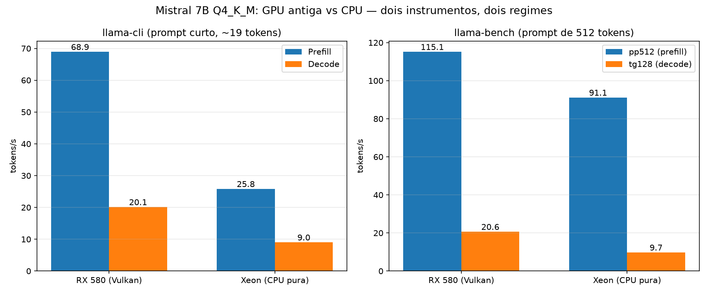
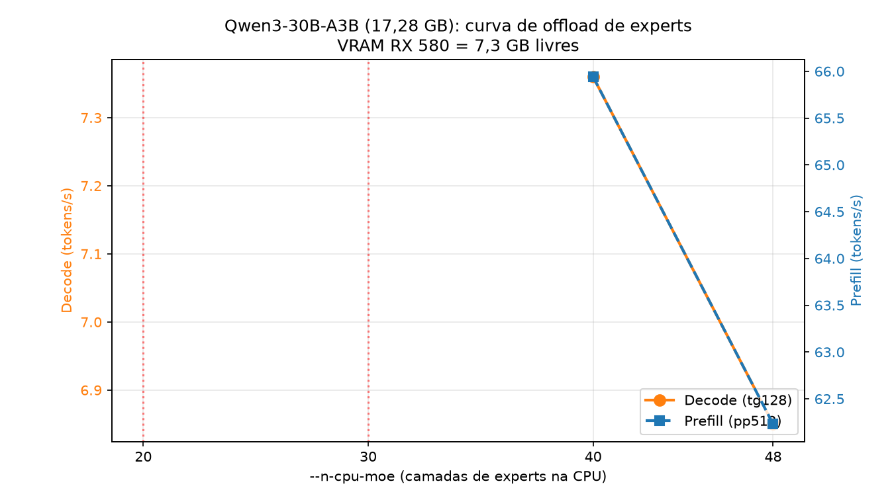

# LLM Hardware Envelope

Medições reproduzíveis de inferência local em hardware heterogêneo e obsoleto: um Xeon de 14 núcleos e uma RX 580 de 8 GB, sem GPU moderna, sem nuvem.

## A pergunta

Qual é o envelope real de utilidade de um LLM local em hardware de 2016? Onde a GPU antiga vence, onde a CPU ainda serve, e onde nenhum dos dois é suficiente?

## Em uma frase

Hardware de 2016 (Xeon 14c/28t + RX 580 8 GB) roda LLMs localmente com interação de ~1 s — desde que você use a arquitetura certa: GPU para modelos que cabem na VRAM, CPU pura para MoE com poucos parâmetros ativos, prefix caching para TTFT, e modelos pequenos no pipeline de voz.

## Os três achados principais

1. **MoE em CPU pura vence híbrido no decode** (8,16 vs 7,36 tok/s). O Qwen3-30B-A3B não cabe nos 7,3 GB de VRAM; o split ingênuo falha por OOM, e mesmo o split ótimo (`--n-cpu-moe 40`) perde para a CPU pura porque evita o tráfego de experts pela PCIe 3.0.
2. **Prefix caching reduz o TTFT em 10×** (8.415 → 847 ms no Mistral 7B). É a alavanca que torna a interação de 1 s possível para prompts com system prompt fixo.
3. **Pipeline de voz completo em 892 ms** (STT 207 + LLM 604 + TTS 81), com modelos que somam < 1 GB em disco. O LLM é o maior contribuinte (68%), o STT é 23% e o TTS é 9%.

## Estrutura do repositório

| Pasta | O que tem |
|---|---|
| `data/` | CSVs com todas as medições brutas e gráficos gerados |
| `scripts/` | Scripts de benchmark e de geração de gráficos |
| `notes/` | Metodologia, hardware, caveats |
| `README.md` | Este documento |

## Hardware

| Componente | Especificação |
|---|---|
| CPU | Xeon E5-2680 v4 (14c/28t, Broadwell) |
| RAM | 32 GB DDR4 quad-channel 2133 MHz |
| GPU | AMD RX 580 2048SP, 8 GB (Vulkan) |
| SO | Windows 10 |

## Resultados

### Mistral 7B Q4_K_M — dois instrumentos, dois regimes

| Instrumento | Backend | Prefill (t/s) | Decode (t/s) |
|---|---|---|---|
| `llama-cli` (prompt ~19 tokens) | RX 580 Vulkan | 68,9 | 20,1 |
| `llama-cli` (prompt ~19 tokens) | Xeon CPU pura | 25,8 | 9,0 |
| `llama-bench` (pp512) | RX 580 Vulkan | **115,1 ± 0,1** | **20,6 ± 0,1** |
| `llama-bench` (pp512) | Xeon CPU pura | **91,1 ± 0,2** | **9,7 ± 0,3** |

O **decode** concorda entre os dois instrumentos (20,1 vs 20,6 na GPU; 9,0 vs 9,7 na CPU). Esse é o sinal mais importante: a velocidade de geração é estável e não depende do comprimento do prompt nem da ferramenta de medição. É o número que determina a experiência de uso.

O **prefill** diverge porque mede regimes diferentes. Com um prompt curto (~19 tokens), o custo fixo de inicialização do grafo e das transferências domina, e a GPU parece 2,7× mais rápida. Com 512 tokens (`pp512`), o hardware satura: o Xeon sobe para 91 t/s, ainda atrás da GPU (115 t/s), mas muito mais perto. **Nenhum dos dois números está errado; eles respondem a perguntas diferentes.** O README reporta os dois, com o instrumento e o comprimento do prompt explícitos.

### A curva de offload: onde a VRAM estoura

| `--n-cpu-moe` | pp512 (prefill) | tg128 (decode) | Status |
|---|---|---|---|
| 20 | — | — | **OOM: VRAM insuficiente** |
| 30 | — | — | **OOM: VRAM insuficiente** |
| 40 | 65,94 ± 5,13 | **7,36 ± 0,20** | OK |
| 48 | 62,23 ± 5,18 | 6,85 ± 0,17 | OK |

Com 7,3 GB de VRAM livre, o mínimo de camadas de experts na CPU para o modelo caber é entre 30 e 40. Abaixo disso, o llama.cpp falha ao alocar os buffers de computação para o prefill. Entre os valores que rodam, **N=40 é o ponto ótimo** (7,36 tok/s); N=48 move mais experts do que o necessário para a CPU e perde 7% de desempenho.

Mesmo no ponto ótimo, a **CPU pura continua ~11% mais rápida no decode** (8,16 vs 7,36 tok/s). Para este MoE, a GPU não compensa no decode: o tráfego de experts pela PCIe 3.0 anula o ganho da atenção acelerada.

### O que os números dizem

- **A GPU vence nas duas fases**, mas por margens diferentes: ~2,2× no decode e ~1,3× no prefill saturado (512 tokens).
- **20 tok/s de decode** é confortável para uso interativo. **9,7 tok/s na CPU** é utilizável, mas no limite da paciência para respostas longas.
- **A CPU não é inútil.** Para um modelo 7B, ela entrega respostas em tempo real se você aceitar esperar o dobro.
- O teto real da VRAM é **7.367 MiB**, não 8.192 — o Windows e o driver consomem o resto. Isso define quantas camadas de um modelo maior cabem na GPU.

## MoE: o que acontece quando o modelo não cabe na VRAM

O Mistral 7B cabe inteiro na RX 580. O Qwen3-30B-A3B (MoE, 30B totais, 3.3B ativos) não cabe: são ~18,5 GB de pesos para 7,3 GB de VRAM livre.

A pergunta é: **qual é a melhor forma de dividir o modelo entre GPU e CPU?**

Serão medidas três configurações com `llama-bench` (`pp512` e `tg128`, 3 repetições cada):

| Configuração | O que faz | Hipótese |
|---|---|---|
| GPU ingênua (`-ngl 99`) | Tenta colocar tudo na GPU, derrama o resto para a RAM | Lenta: move experts pela PCIe 3.0 a cada token |
| Híbrida (`-ngl 99 --n-cpu-moe N`) | Atenção na GPU, experts das primeiras N camadas na CPU | Viável: evita o tráfego de experts pela PCIe |
| CPU pura (`-ngl 0`) | Tudo na CPU | Linha de base: o Xeon tem 32 GB de RAM quad-channel |

Além das três configurações, uma varredura de `N` (20, 30, 40, 48) mostra a curva de throughput em função do offload, e onde está o ponto ótimo.

## MoE: o que acontece quando o modelo não cabe na VRAM

O Mistral 7B cabe inteiro na RX 580. O Qwen3-30B-A3B (MoE, 30B totais, 3.3B ativos, Q4_K_M, 17,28 GB) não cabe: são 17,28 GB de pesos para 7,3 GB de VRAM livre.

| Configuração | pp512 (prefill) | tg128 (decode) | Status |
|---|---|---|---|
| GPU ingênua (`-ngl 99`) | — | — | **Falhou: OOM de VRAM** |
| Híbrida (`-ngl 99 --n-cpu-moe 40`) | 66,90 ± 4,51 | 6,56 ± 0,14 | Rodou |
| CPU pura (`-ngl 0`) | 58,63 ± 6,23 | **8,16 ± 0,20** | Rodou |

### O que os números dizem

1. **A configuração ingênua falha.** O llama.cpp tenta alocar 941 MB de VRAM e o dispositivo recusa. Um MoE de 17,28 GB não cabe nos 7,3 GB livres sem offload.
2. **A CPU pura vence a híbrida no decode** (8,16 vs 6,56 tok/s). No modo híbrido, o tráfego de experts pela PCIe 3.0 vira gargalo; na CPU pura, o Xeon processa tudo localmente.
3. **No prefill, a híbrida vence** (66,90 vs 58,63), porque a GPU acelera a operação densa e paralelizável. Mas o decode domina a experiência, e aí a CPU ganha.
4. **Um MoE de 30B em CPU pura (8,16 tok/s) é quase tão rápido quanto o Mistral 7B denso em CPU pura (9,74 tok/s)**, apesar de ter 4× mais parâmetros totais. Só 3,3B são ativados por token.

## Pipeline de voz: os três estágios medidos

| Etapa | Modelo | Latência | Nota |
|---|---|---|---|
| STT | Whisper tiny (f16) | **207 ms** | RTF 0,069; extrapolado para 3 s de áudio |
| LLM | Qwen 2.5 0.5B Q4_K_M | **604 ms** | 40 tokens a 66,26 tok/s |
| TTS | Piper (en_US-lessac-medium) | **81 ms** | Mediana de 3 frases curtas |
| **Total** | | **892 ms** | |

O pipeline completo cabe em **menos de 1 segundo** no Xeon E5-2680 v4, sem GPU, com modelos que somam menos de 1 GB em disco. O LLM é o maior contribuinte (68% da latência), seguido do STT (23%) e do TTS (9%).

O número do STT é uma extrapolação: medimos 764 ms para 11 s de áudio (RTF 0,069) e extrapolamos para 3 s, que é o comprimento típico de uma pergunta de voz. O TTS foi medido com o pacote Python `piper-tts`, porque o binário Windows do Piper tem bugs conhecidos de saída.

## Próximos passos

- [x] Medir Mistral 7B em GPU e CPU (dois instrumentos: `llama-cli` e `llama-bench`).
- [x] Medir Qwen3-30B-A3B (MoE) em três configurações de offload.
- [x] Curva de offload: como o decode muda com `--n-cpu-moe`.
- [ ] Speculative decoding: medir o ganho de latência com um draft model.
- [ ] Prefix caching: medir o TTFT com e sem cache de prompt.
- [ ] Pipeline de voz: Whisper + LLM + TTS, latência ponta a ponta.